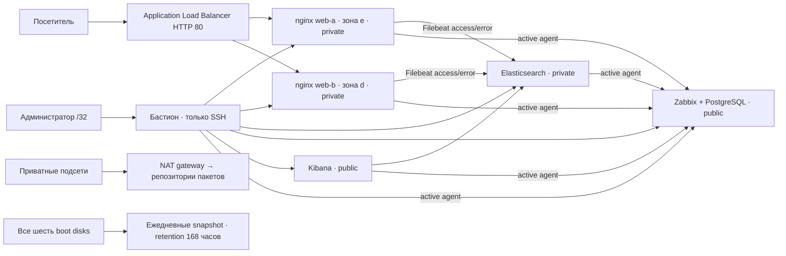

# Отказоустойчивая инфраструктура сайта в Yandex Cloud

## Цель и границы

Развернуть статический сайт с двумя одинаковыми nginx в разных зонах доступности, облачным Application Load Balancer, мониторингом USE, централизованными журналами и ежедневными резервными копиями всех загрузочных дисков. Инфраструктура описана Terraform, конфигурация Linux — Ansible. Код и доказательства проверок размещаются в отдельном репозитории.

Отказоустойчивость относится к веб-уровню: отказ одного nginx не должен прерывать выдачу сайта после исключения узла health check. Zabbix, Elasticsearch и Kibana работают в одном экземпляре каждый; отказ этих сервисов не закрывает сайт, но временно прекращает мониторинг или поиск журналов. Проверка остановки nginx не моделирует отказ всей зоны.

## Архитектура

Все ВМ используют один закреплённый образ Ubuntu 22.04 LTS. На каждой — два vCPU Intel Ice Lake с гарантированной долей 20%. В квоте Yandex Cloud это 0,4 CPU на ВМ, всего 1,2 CPU в каждой зоне. Суммарно выделено 12 виртуальных CPU; гарантированная доля соответствует 2,4 CPU. Это учебный стенд без обещаний производительности при большой нагрузке.

| ВМ | Зона | Память, гигабайт | Диск, гигабайт | Публичный адрес |
|---|---|---:|---:|---|
| web-a | e | 2,15 | SSD 10,74 | Нет |
| web-b | d | 2,15 | SSD 10,74 | Нет |
| Elasticsearch | d | 4,29 | SSD 21,47 | Нет |
| Zabbix/PostgreSQL | d | 4,29 | SSD 21,47 | Да, интерфейс ограничен /32 |
| Kibana | e | 4,29 | HDD 10,74 | Да, интерфейс ограничен /32 |
| Бастион | e | 2,15 | HDD 10,74 | Да, только SSH |

Размеры приведены в десятичных единицах. Все шесть ВМ для сдачи непрерываемые. На время длительного перерыва стенд следует останавливать; диски, снимки, адреса, NAT и балансировщик могут продолжать тарифицироваться. Полное удаление собственных ресурсов выполняется Terraform после сохранения нужных данных.

## Решения и компромиссы

Использована существующая VPC через Terraform data source. В ней созданы отдельные подсети и группы безопасности диплома. Это сохраняет одну VPC для всех компонентов проекта и обходит заполненную квоту количества сетей. Terraform не управляет прежними ВМ и не изменяет существующую сеть. Квоты CPU удалось соблюсти без увеличения благодаря правильному учёту гарантированной доли CPU; диски распределены между доступными SSD и HDD в d/e.

Пять cloud security groups разделяют бастион, web, Elasticsearch, UI и ALB. Общая UI-группа для Zabbix/Kibana экономит квоту; UFW на каждой из этих ВМ разрешает только её собственный UI-порт. SSH к серверам идёт через бастион. Бастион принимает снаружи только TCP 22 с административного /32; агенты мониторинга активные и не открывают входящий 10050.

Elasticsearch принимает 9200 только от web/UI-групп; доступ снаружи отсутствует. Filebeat использует отдельного пользователя с записью только в `nginx-*`. Kibana использует `kibana_system`; пароли разных сервисов различаются. Администратор использует SSH-туннели. Для руководителя открыт HTTPS 443 через нативный nginx reverse proxy на каждой UI-ВМ, с отдельным read-only пользователем. Домен не предоставлен, поэтому сертификаты самоподписанные с IP SAN: публичные копии и отпечатки приложены в ACCESS.md. Исходные 8080/5601 доступны снаружи только административному /32.

Сервисы установлены подписанными пакетами и управляются systemd. Контейнеры не нужны. Из-за HTTP 403 у официального Elastic APT index используется зеркало Yandex с исходным ключом Elastic и проверкой подписи APT; Elasticsearch, Filebeat и Kibana закреплены на одной версии 8.19.23. Terraform provider закреплён lock-файлом. Inventory содержит FQDN `.ru-central1.internal`, SSH-ключ остаётся на рабочем месте. Публичные host keys сверены с аутентифицированным serial API облака.

## Мониторинг USE

На всех шести узлах установлен Zabbix agent с активными проверками и стандартным шаблоном Linux. Дополнительный root-owned сборщик запускается systemd timer каждые 15 секунд и атомарно записывает JSON. Агент только читает этот файл; произвольные команды от Zabbix не разрешены. Основные источники — `/proc`, `/sys`, root filesystem и журнал ядра гостевой ОС.

| Ресурс | Utilization | Saturation | Errors и пороги |
|---|---|---|---|
| CPU | Busy %, порог 80% | Load/core >1, runnable, PSI | Сообщения гостевого ядра BUG/lockup |
| RAM | Занято >90%, доступные байты | PSI, swap pages/s | OOM kills >0 |
| Диск | Занято >80%, IO busy >90% | Await >50 мс, requests in flight, PSI | Guest kernel I/O errors >0 |
| Сеть | RX/TX байт/с | Drops/s как сигнал переполнения очередей | Errors/s >0 |
| HTTP | RPS | Active/waiting, средняя задержка >1 с | 5xx >1% при выборке ≥20 запросов, failed scenario |

Для продолжительных нагрузок используются окна пять минут. Пороговые линии на классических графиках построены отдельными calculated items и соответствуют условиям триггеров. Dashboard содержит страницу каждого узла и дополнительные HTTP-графики для обоих nginx. Экспорт конфигурации и dashboard находится в `evidence/`.

Ограничения измерений: аппаратные ошибки физического хоста не видны гостевой ОС; гостевой журнал не заменяет телеметрию оборудования. Скорость сети показывается в абсолютных величинах — фиксированную пропускную способность облачного интерфейса стенд не предполагает. HTTP-статистика за последнюю минуту вычисляется по дополнительному JSON access log с ограничением чтения; при усечении выборки поднимается отдельный сигнал. В HTTP RPS входят health checks и мониторинговые запросы. Первая точка счётчика после перезапуска не используется для оценки скорости.

## Журналы

Оба nginx ведут обычный access.log и error.log. Два Filebeat filestream input добавляют поле `log_type=access|error`, затем отправляют события напрямую в Elasticsearch. Индекс `nginx-*` доступен в Kibana с временным полем `@timestamp`. Дополнительный `metrics.log` нужен только для HTTP-метрик и не подменяет требуемые access/error-журналы. Для демонстрации error.log выполняется запрещённый запрос к `/nginx_status` с другого узла; ожидается 403.

## Резервное копирование

Terraform создаёт одно ежедневное snapshot schedule с retention 168 часов, подключённое ко всем шести boot disks. Для локального PostgreSQL перед облачным копированием ежедневно создаётся логический дамп `pg_dump --format=custom`; запись атомарная, каталог 0700, хранение семь дней. Снимки работающих ВМ crash-consistent, поэтому для восстановления Zabbix отдельно проверяется логический дамп.

Проверка восстановления выполняется на временном диске/временной БД; основные данные не перезаписываются. После проверки временные ресурсы удаляются. Протокол содержит ID снимка, исходного диска, результат чтения файлов и совпадение контрольной суммы сайта; для PostgreSQL — результат `pg_restore` и проверку управляемых узлов. Доказательства ручного и планового копирования различаются явно.

## Приёмка и доступ

Рассмотрены три варианта: полная нативная схема из шести ВМ (выбрана, ориентир 24–40 часов без ожидания облака); временный двухмашинный прототип (использован для отладки, не соответствует полной сдаче); шесть ВМ с официальными Elastic-контейнерами (резерв при недоступности пакетов, ориентир 20–36 часов). Нативный вариант выбран ради обычного администрирования пакетами, systemd и Ansible. Главные риски — квоты, доступность мощностей во время инцидента, репозитории Elastic и минимальные диски. Уточнение учёта CPU и распределение SSD/HDD позволили продолжить без увеличения CPU; лимит снимков увеличен до 96.

Матрица требований и фактические протоколы находятся в [ACCEPTANCE.md](ACCEPTANCE.md). Команды развёртывания и обслуживания — в [RUNBOOK.md](RUNBOOK.md). Текущие URL и результаты финальных проверок фиксируются в README после завершения реального развёртывания. Закрытые ключи, пароли, IAM-токены, state, tfvars и планы не публикуются. История двухмашинного прототипа остаётся в evidence как история и не подменяет доказательства полного стенда.
